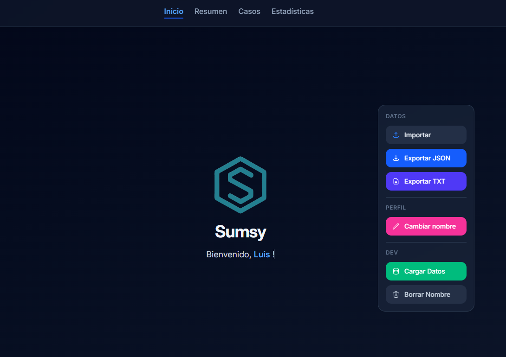

# Sumsy


**Sumsy** is a modern, high-performance desktop application designed to manage case data and summaries efficiently. Built with the latest web technologies, it offers a seamless native experience powered by Tauri and the reactive speed of Vue 3.



## ✨ Features

- **Blazing Fast**: Powered by Tauri's Rust backend for minimal resource usage.
- **Modern UI**: Polished interface with glassmorphism, dark mode, a subtle dot-grid background and smooth transitions.
- **Minimalist Architecture**: Clean, centered layouts with a dedicated sidebar for all actions, maintaining visual simplicity.
- **Data Management**: Add, edit, sort (with animated reordering) and delete cases and summaries.
- **Extra Cases**: Check "Extra" when adding a case, or toggle the star on any row. Filter by all, normal or extra cases; older cases count as normal.
- **Statistics**:
  - **Activity calendar**: a GitHub-style heatmap of the last year whose cells get deeper with more items per day, with streaks, filters (summaries, cases, extras) and keyboard navigation.
  - **All-time share**: a doughnut chart with the percentage of summaries, cases and extra cases.
  - **Evolution**: bar charts for the last 7, 30 or 90 days, or 12 months grouped by week; extra cases are stacked on top of normal ones.
- **Monthly Export**: Exports the current month by default (JSON or TXT report; the report lists extra cases in their own section). You can pick a past month (year above, month name below) or make a full backup.
- **Safe Import**: Imported JSON files are merged by id and malformed items are skipped.
- **Motion with care**: Directional view transitions, scroll reveal and a "back to top" button, all respecting `prefers-reduced-motion`.
- **Desktop Native**: Works offline with native operating system integration.

### Development tools

In development mode (`yarn tauri dev`), the sidebar shows a **Dev** section that production builds hide:

- **Cargar Datos**: adds 30 sample summaries.
- **Generar demo**: fills the last 12 months with 20–50 random summaries and 20–50 random cases per month, plus 30–50 extra cases in total, to try the charts and every behavior.
- **Borrar Nombre**: clears the user name.

## 🛠 Tech Stack

- **Core**: [Tauri 2](https://tauri.app/) (Rust + WebView)
- **Frontend**: [Vue 3](https://vuejs.org/) (Composition API)
- **Styling**: [TailwindCSS 4](https://tailwindcss.com/) + Glassmorphism
- **State Management**: [Pinia](https://pinia.vuejs.org/) (with persistence)
- **Tooling**: [Vite](https://vitejs.dev/) + [TypeScript](https://www.typescriptlang.org/)
- **Testing**: [Vitest](https://vitest.dev/)

## 🚀 Getting Started

### Prerequisites

- [Node.js](https://nodejs.org/) (v18+)
- [Rust](https://www.rust-lang.org/tools/install) (for Tauri development)
- [Yarn](https://yarnpkg.com/) (the project uses `yarn.lock`)

### Installation

1.  **Clone the repository**

    ```bash
    git clone https://github.com/userlg/sumsy
    cd sumsy
    ```

2.  **Install Dependencies**

    ```bash
    yarn install
    ```

3.  **Run Development Mode**
    Start the Vite dev server and Tauri window:

    ```bash
    yarn tauri dev
    ```

4.  **Build for Production**
    Generate the native installer/executable:
    ```bash
    yarn tauri build
    ```

## 📂 Project Structure

```bash
src/
├── assets/      # Static assets (images, fonts)
├── components/  # Local components
├── logic/       # Pure business logic (activity, charts, export, demo data)
├── modules/     # Feature-based architecture
├── pages/       # Vue Router views
├── scripts/     # Utility scripts
├── shared/      # Shared components, styles, and utilities
│   ├── components/  # Reusable UI components (NavBar, ActivityHeatmap, ShareDonut, etc.)
│   ├── composables/ # Shared composition functions (useScrollY)
│   ├── directives/  # Custom directives (v-reveal)
│   ├── stores/      # Base list store shared by cases and summaries
│   ├── styles/      # Global styles, tokens and transitions (Tailwind)
│   └── utils/       # Helpers (date parsing and formatting)
├── stores/      # Pinia state stores
├── App.vue      # Root component
└── main.ts      # Application entry point
```

## 🧪 Testing

Run the test suite with Vitest:

```bash
yarn test           # Run unit tests
yarn coverage       # Generate coverage report
```

## 🤝 Contributing

Contributions are welcome! Please check [CONTRIBUTING.md](CONTRIBUTING.md) for guidelines.

## 📜 License

This project is licensed under the [MIT License](LICENSE.md).

---

© 2026 Sumsy
