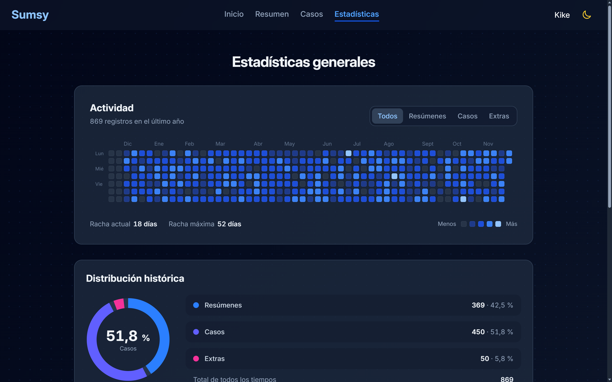
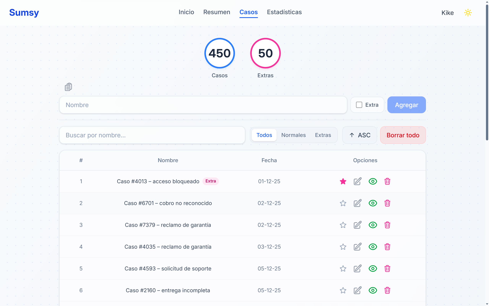
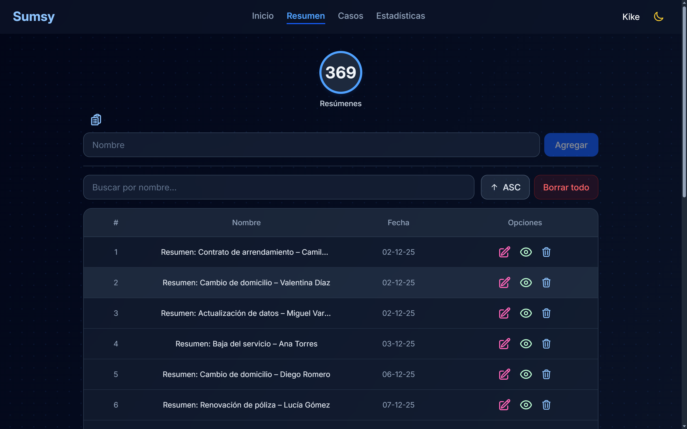
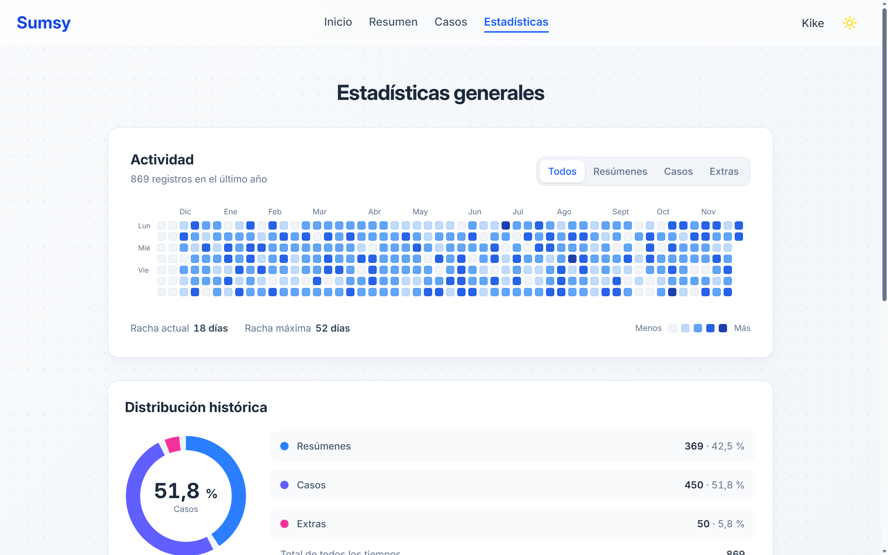
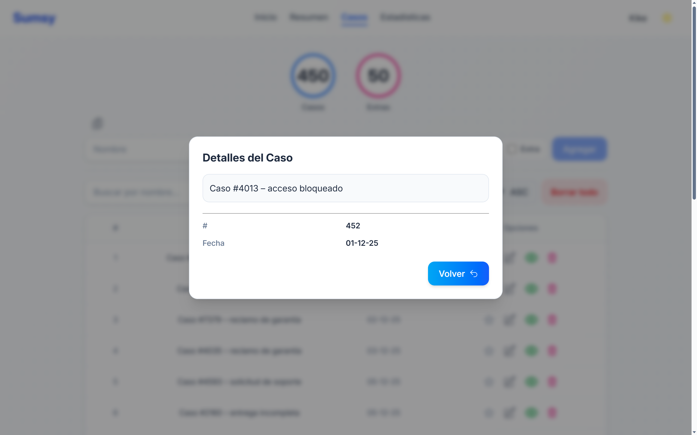

# Sumsy: desktop tracker for daily work cases and summaries

[](https://github.com/userlg/sumsy/releases/latest)
[](https://github.com/userlg/sumsy/releases/latest)
[](LICENSE.md)


**Sumsy** is a free, open-source desktop app for logging the cases and summaries you work on each day, counting them, and reporting them by month. It runs offline on Windows, keeps your data on your computer, and shows your activity in a calendar heatmap and charts. Built with Tauri 2 (Rust), Vue 3, TypeScript and Tailwind CSS.

The interface is in Spanish.

## ⬇️ Download

Get the installer from the [latest release](https://github.com/userlg/sumsy/releases/latest):

- `Sumsy_x.y.z_x64-setup.exe`: Windows installer
- `Sumsy_x.y.z_x64_en-US.msi`: MSI package

## 📸 Screenshots



<table>
  <tr>
    <td></td>
    <td></td>
  </tr>
  <tr>
    <td align="center"><sub>Cases, with extra cases marked by a star</sub></td>
    <td align="center"><sub>Summaries, in dark mode</sub></td>
  </tr>
  <tr>
    <td></td>
    <td></td>
  </tr>
  <tr>
    <td align="center"><sub>Statistics, in light mode</sub></td>
    <td align="center"><sub>Case details in a native modal dialog</sub></td>
  </tr>
</table>

## ✨ Features

- **Blazing Fast**: Powered by Tauri's Rust backend for minimal resource usage.
- **Modern UI**: Polished interface with glassmorphism, dark mode, a subtle dot-grid background and smooth transitions.
- **Minimalist Architecture**: Clean, centered layouts with a dedicated sidebar for all actions, maintaining visual simplicity.
- **Data Management**: Add, edit, search and delete cases and summaries. Lists are ordered by date (ascending or descending), so an item added or edited with an earlier date moves into place.
- **Extra Cases**: Check "Extra" when adding a case, or toggle the star on any row. Separate counters for normal and extra cases, and a filter for all, normal or extra.
- **Statistics**:
  - **Activity calendar**: a GitHub-style heatmap of the last year whose cells get deeper with more items per day, with streaks, filters (summaries, cases, extras) and keyboard navigation.
  - **All-time share**: a doughnut chart with the percentage of summaries, cases and extra cases.
  - **Evolution**: bar charts for the last 7, 30 or 90 days, or 12 months grouped by week; extra cases are stacked on top of normal ones.
- **Monthly Export**: Exports the current month by default (JSON or TXT report; the report lists extra cases in their own section). You can pick a past month (year above, month name below) or make a full backup.
- **Safe Import**: Imported JSON files are merged by id, malformed items are skipped, and the result counts summaries, cases and extras.
- **Accessible**: Keyboard tooltips on icon buttons, native modal dialogs (`<dialog>`: focus kept inside, Escape to close, focus returned to where it was), and a single screen-reader announcement when the list order changes.
- **Motion with care**: Directional view transitions, scroll reveal and a "back to top" button, all respecting `prefers-reduced-motion`.
- **Desktop Native**: Works offline with native operating system integration.

### Development tools

In development mode (`yarn tauri dev`), the sidebar shows a **Dev** section that production builds hide:

- **Cargar Datos**: adds 30 sample summaries.
- **Generar demo**: fills the last 12 months with 20–50 random summaries and 20–50 random cases per month, plus 30–50 extra cases in total, to try the charts and every behavior.
- **Borrar Nombre**: clears the user name.

## 🛠 Tech Stack

- **Core**: [Tauri 2](https://tauri.app/) (Rust + WebView2; needs a current WebView2 runtime, Chromium 121 or later, which Windows 10 and 11 keep up to date)
- **Frontend**: [Vue 3](https://vuejs.org/) (Composition API)
- **Styling**: [TailwindCSS 4](https://tailwindcss.com/) + Glassmorphism
- **State Management**: [Pinia](https://pinia.vuejs.org/) (with persistence)
- **Tooling**: [Vite](https://vitejs.dev/) + [TypeScript](https://www.typescriptlang.org/)
- **Testing**: [Vitest](https://vitest.dev/)

## 🚀 Getting Started

### Prerequisites

- [Node.js](https://nodejs.org/) (v18+)
- [Rust](https://www.rust-lang.org/tools/install) (for Tauri development)
- [Yarn](https://yarnpkg.com/) (the project uses `yarn.lock`)

### Installation

1.  **Clone the repository**

    ```bash
    git clone https://github.com/userlg/sumsy
    cd sumsy
    ```

2.  **Install Dependencies**

    ```bash
    yarn install
    ```

3.  **Run Development Mode**
    Start the Vite dev server and Tauri window:

    ```bash
    yarn tauri dev
    ```

4.  **Build for Production**
    Generate the native installer/executable:
    ```bash
    yarn tauri build
    ```

## 📂 Project Structure

```bash
src/
├── logic/       # Pure business logic (activity, charts, export, demo data)
├── modules/     # Feature modules: cases and summaries (view + store)
├── pages/       # Home and statistics pages
├── router/      # Routes and scroll behavior
├── scripts/     # Utility scripts (reset app data)
├── shared/      # Shared building blocks
│   ├── components/  # BaseModal, BaseTable, AddItemForm, Tooltip, charts, heatmap...
│   ├── composables/ # useDataTransfer (export/import), useNotify, useScrollY
│   ├── directives/  # Custom directives (v-reveal)
│   ├── icons/       # SVG icons, imported as components
│   ├── stores/      # Base list store shared by cases and summaries
│   ├── styles/      # Global styles, tokens and transitions (Tailwind)
│   └── utils/       # Date and case helpers
├── stores/      # User and dark mode stores
├── App.vue      # Root component
└── main.ts      # Application entry point
```

## 🧪 Testing

Run the test suite with Vitest:

```bash
yarn test           # Run unit tests
yarn coverage       # Generate coverage report
```

## 🤝 Contributing

Contributions are welcome! Please check [CONTRIBUTING.md](CONTRIBUTING.md) for guidelines.

## 📜 License

This project is licensed under the [MIT License](LICENSE.md).

---

© 2026 Sumsy
